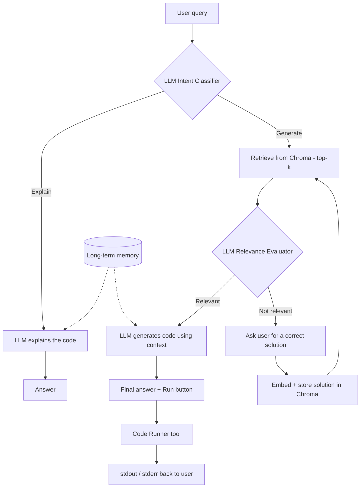

# 🧠 RAG the Code

**A self-learning AI coding assistant that knows when it doesn't know.**

Most coding chatbots answer everything with the same confidence, even when they're guessing. RAG the Code is built differently: it first works out *what you're asking*, routes you down the right pipeline, checks whether its knowledge base actually contains something useful, and, when it doesn't, asks you to teach it instead of making something up.

---

## 🎯 Project Objectives

Build an intelligent assistant that can:

- **Classify intent**: decide whether the user wants code *explained* or *generated*.
- **Route intelligently**: explanations go straight to the LLM (no retrieval); generation requests go through a RAG pipeline.
- **Retrieve knowledge** from a Chroma vector database (documents, embeddings, metadata, sources).
- **Judge its own retrieval**: a second LLM acts as a relevance evaluator before any retrieved context is used.
- **Refuse to hallucinate**: if nothing relevant is found, it says so and asks the user for a correct solution.
- **Learn from feedback**: user-provided solutions are embedded and stored so the knowledge base grows over time.
- **Remember**: long-term conversation memory (past questions, generated code, language and framework preferences).
- **Execute code safely** through a dedicated code-runner tool (the LLM never runs code itself).
- **Present it all** in a Streamlit chat interface with streaming and syntax highlighting.

---

## 🏗️ System Architecture



**Key design rules**

1. The **explain path never touches RAG**: no retrieval, no embeddings, just the LLM.
2. Retrieved documents are **never used before being judged** by the relevance evaluator.
3. When the evaluator is unsure, it **fails safe** to "Not Relevant", because asking the user for a reference is better than hallucinating.
4. **The LLM never executes code.** A separate tool does, and it reports the output back.

---

## 🛠️ Technologies

| Layer | Tool |
|---|---|
| Language | Python |
| Orchestration | LangChain (`langchain-core`, `langchain-openai`, `langchain-chroma`, `langchain-huggingface`) |
| Vector database | Chroma (persistent, cosine distance) |
| Embeddings | `sentence-transformers/all-MiniLM-L6-v2` (runs locally) |
| LLM access | OpenRouter (OpenAI-compatible API) |
| Knowledge base | HumanEval + MBPP (via Hugging Face `datasets`) |
| UI *(planned)* | Streamlit |

---

## 📚 Knowledge Base

| Dataset | Problems | What it provides |
|---|---|---|
| [HumanEval](https://huggingface.co/datasets/openai/openai_humaneval) | 164 | Function signature + docstring, reference solution, unit tests |
| [MBPP](https://huggingface.co/datasets/google-research-datasets/mbpp) (full config) | 974 | Plain-English task description, solution code, test assertions |

**Total: 1,138 documents**, each stored with metadata (`task_id`, `source`, `language`, `test`, and more). IDs are prefixed (`HumanEval/7`, `MBPP/12`), so re-running ingestion upserts instead of duplicating.

**Known coverage limits** (verified with a keyword scan): the data contains no Kruskal, BFS, or Dijkstra tasks, and "factorial" appears only in variants such as digit-counting. These gaps are exactly what the relevance check and the feedback-learning loop are designed to handle.

---

## 📁 Repository Structure

```
RAG-the-Code/
├── app.py                    # Streamlit UI (planned)
├── requirements.txt
├── .env.example
├── README.md
│
├── src/
│   ├── config.py             # paths, model names, top-k, env loading
│   ├── loader.py             # HumanEval + MBPP -> LangChain Documents
│   ├── vectorstore.py        # Chroma create / load / add / retrieve (with distances)
│   ├── llm.py                # single place that builds the LLM client
│   ├── classifier.py         # intent: explain vs generate
│   ├── relevance.py          # LLM relevance evaluator
│   ├── router.py             # (planned) routes queries + handles feedback turn
│   ├── generator.py          # (planned) explain + generate chains
│   ├── memory.py             # (planned) long-term conversation memory
│   ├── feedback.py           # (planned) store user-taught solutions
│   └── code_runner.py        # (planned) sandboxed code execution tool
│
├── scripts/
│   ├── validate_loader.py    # structural + retrieval checks on the loader
│   ├── ingest.py             # one-time: load dataset into Chroma
│   └── check_pipeline.py     # pre-flight health check for everything built so far
│
└── data/
    └── chroma_db/            # persisted vector store (git-ignored)
```

---

## ✅ What We've Achieved So Far

| Component | Status |
|---|---|
| Dataset loader (HumanEval + MBPP) | ✅ Done and validated (1,138 docs, unique IDs, Chroma-safe metadata) |
| Persistent Chroma vector store | ✅ Done, ingestion is idempotent (re-run keeps the count at 1,138) |
| Retrieval with cosine distances | ✅ Done |
| Intent classifier | ✅ Working (explain vs generate) |
| Relevance evaluator | 🟡 Written, awaiting live testing |
| Pre-flight check script | 🟡 Written, awaiting a full run |
| Generator, router, memory, feedback, code runner, UI | ⏳ Next |

**Findings along the way**

- **Retrieval signal is real.** In a first check, a query covered by the data (GCD) matched at distance **0.279**, while an uncovered one (Kruskal's algorithm) only reached **0.609**, and its three results were all off-topic. Vector search always returns *something*, which is why the LLM relevance check is essential.
- **Free LLM routers aren't deterministic.** A free-tier router slug rotated between models, one of which was a content-safety model that ignored the classification prompt. Lesson: pin one specific model and make parsers fail loudly instead of silently.
- **Free-tier quotas matter.** A daily cap on free-model requests shaped how we test: cheap distance gates before LLM calls, and short test sets.

---

## 🚀 Getting Started

```bash
# 1. Clone and enter the repo
git clone <your-repo-url>
cd RAG-the-Code

# 2. Create a virtual environment and install dependencies
python -m venv venv
venv\Scripts\activate          # Windows (use `source venv/bin/activate` on macOS/Linux)
pip install datasets langchain-core langchain-openai langchain-chroma \
            langchain-huggingface sentence-transformers python-dotenv

# 3. Configure your LLM
cp .env.example .env           # then fill in your key and a pinned model name

# 4. Build the knowledge base (one time)
python -m scripts.ingest

# 5. Verify everything
python -m scripts.check_pipeline
```

**`.env` example**

```dotenv
OPENROUTER_API_KEY=your_key_here
OPENROUTER_MODELS=provider/model-name      
LLM_BASE_URL=https://openrouter.ai/api/v1
```


---

## 🗺️ Roadmap

1. Validate `relevance.py` and calibrate the distance cutoff from measured data
2. Build the explain and generate chains (`generator.py`)
3. Build the router, including the *awaiting-solution* state for the feedback turn
4. Implement human-feedback learning (embed + store user solutions)
5. Add long-term memory with its own separate collection
6. Build the sandboxed code runner (subprocess, timeout, captured output)
7. Wrap everything in a Streamlit app with streaming and syntax highlighting

---

## 👤 Author

Built by **Ammar Mohamed** as part of the Cellula NLP program.